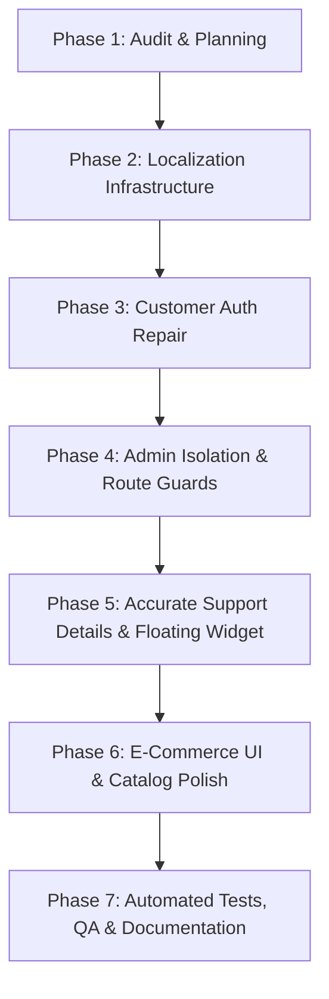

# Doodhwala — Remediation & Upgrade Implementation Plan

## 1. Objectives & Architectural Principles

Transform the existing Doodhwala dairy platform into a high-trust, responsive, multilingual e-commerce platform that:
1. **Defaults to Hindi (`hi`)** on first visit with natural Devanagari copy.
2. Supports **Hindi (`hi`)**, **English (`en`)**, **Braj Bhasha (`brx`)**, and **Marwari Bhasha (`mwr`)** with culturally respectful terminology, persistent across visits.
3. Completely fixes **Customer Authentication**: eliminates mock auto-sessions, validates credentials, enforces proper registration, and integrates Supabase Auth with secure local fallback.
4. Strictly isolates **Admin Operations**: creates `/admin/login`, eliminates header privilege switchers, and guards all administrative routes.
5. Accurately renders **Official Customer Support Information**: embeds Biaora, Rajgarh (MP) coordinates, the 4 designated family phone numbers, and a floating contact widget.
6. Delivers an enhanced e-commerce UI: improves product card layouts, unit readability, cart calculations, atomic order creation, and status progression.
7. Validates every requirement through comprehensive automated Vitest test suites.

---

## 2. Implementation Phases & Sequence

### Phase 2: Localization Framework (4 Languages)
- **Files**:
  - `src/locales/types.ts`: TypeScript definition for all UI dictionary keys.
  - `src/locales/hi.ts`: Natural Hindi translation (Default).
  - `src/locales/en.ts`: Clear English translation.
  - `src/locales/brx.ts`: Authentic Braj Bhasha translation in Devanagari.
  - `src/locales/mwr.ts`: Warm, respectful Marwari Bhasha translation in Devanagari.
  - `src/context/LanguageContext.tsx`: React Context providing `useLanguage()`, `t(key)`, `language`, `setLanguage`, persisting to `localStorage` (`doodhwala_lang_v1`).
- **UI**: Embed accessible language switcher in `Navbar.tsx` and mobile drawer.

### Phase 3: Customer Authentication Repair
- **Files**:
  - `src/lib/store.tsx`: Remove hardcoded default `currentUser`. Initialize to `null`.
  - Maintain `STORAGE_KEYS.USERS` with registered customer accounts.
  - Fix `login()`: Validate credentials against stored users or Supabase Auth. Reject arbitrary unverified inputs.
  - Fix `signup()`: Prevent duplicate email/phone registrations, assign `role: 'customer'`, and validate password length.
  - Fix `logout()`: Clean state reset.
  - `src/pages/auth/LoginPage.tsx`: Clean customer login form with accurate validation and error states.
  - `src/pages/auth/SignupPage.tsx`: Full registration flow.

### Phase 4: Administrative Security & Isolation
- **Files**:
  - Remove `#role-switch-button` from `src/components/layout/Navbar.tsx`.
  - Create `src/pages/admin/AdminLoginPage.tsx` accessible at `/admin/login`.
  - Enforce role check: Only users with `role === 'admin'` can access `/admin/*`.
  - Build `AdminRouteGuard` redirecting unauthorized users to `/admin/login`.

### Phase 5: Official Support Information & Floating Widget
- **Files**:
  - `src/lib/initialData.ts`: Update business name, email (`doodhwala@gmail.com`), address (`Khajuriya, Biaora, Rajgarh, MP - 465674`), and the 4 support contacts.
  - `src/components/common/SupportWidget.tsx`: Floating support launcher displaying click-to-call links (`tel:`), email link (`mailto:`), and direct WhatsApp support.
  - Update `src/components/layout/Footer.tsx` and `src/pages/public/ContactPage.tsx`.

### Phase 6: E-Commerce UI & Catalog Polish
- Verify `/products` filter tabs, search, variant selectors, stock labels.
- Verify Cart & Checkout atomic calculations and UPI manual verification flow.
- Ensure all text across cards, buttons, badges, and headers consumes `t(key)`.

### Phase 7: Testing, Verification & Final Documentation
- Write unit tests in `src/test/localization.test.ts` ensuring 100% dictionary key coverage for all 4 languages.
- Write unit tests in `src/test/auth.test.ts` proving login rejection of invalid credentials, customer isolation, and admin protection.
- Run `npm test` and `npm run build`.
- Produce `QA_REPORT.md` and updated `README.md`.

---

## 3. Acceptance Criteria

1. On a fresh browser visit without prior storage, the website renders in **Hindi** (`hi`).
2. Switching language to English, Braj, or Marwari updates all visible interface copy instantly without page refresh and persists on reload.
3. Typing random credentials or arbitrary Gmail addresses on `/login` fails with a clear validation error.
4. Anonymous users or regular customer accounts cannot access `/admin`; attempting to visit `/admin` redirects to `/admin/login`.
5. Official Doodhwala contact details (Biaora, Rajgarh, MP and 4 Dangi family phone numbers) are visible and clickable across all languages.
6. Production build passes cleanly with zero TypeScript errors (`tsc && vite build`).
7. All automated unit and security tests pass with 100% success.
